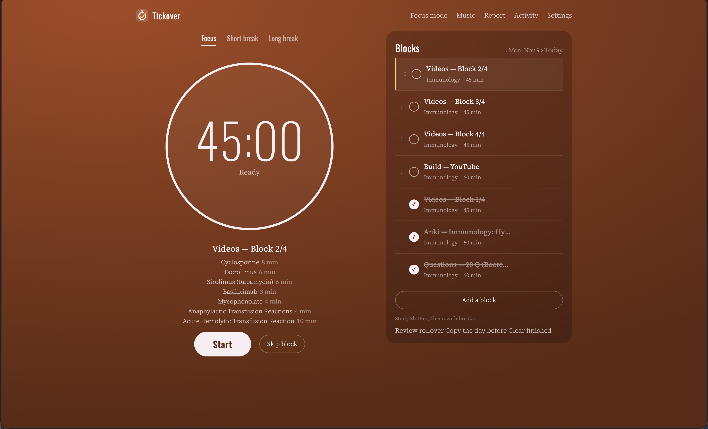
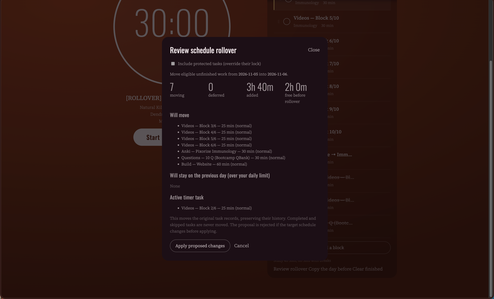

# Tickover


**A free study planner with a built-in Pomodoro timer. Plan your day as blocks, and anything you don't finish rolls over to tomorrow.**

Tickover is for people whose day is planned in tasks, not just in timer sessions. Use it as a standalone study timer, or optionally connect an AI assistant to create and adjust your plan for you.

It is free and open source. Your data is stored on your own computer: no account, no cloud, no subscription.



**Jump to:** [Install](#install) · [Features](#features) · [How rollover works](#how-rollover-works) · [Connect an AI assistant](#connect-an-ai-assistant) · [Backups](#backups-and-your-data) · [Security](#security-and-sharing)

---

## Features

- **Plan your day as blocks.** Each block has a subject, a type, optional sub-items and a duration. Edit them any time.
- **Priorities and deadlines.** Mark work critical, high, normal or low, and optionally set a due date.
- **Locked blocks.** Lock a block and rollover will never move it.
- **Rollover.** See what you left unfinished over the last 31 days, review it, move it to today, and undo it if you change your mind.
- **Optional daily study limit.** Turn it on and rollover only moves what actually fits in your day.
- **Full Pomodoro timer.** Focus, short break and long break, with ticking sounds, chimes, optional music, focus mode, notifications and weekly reports.
- **Keeps running when you close the tab.** The timer lives in the app, not the browser tab, so reopening the page restores your current session. With auto-advance on, it also moves on to the next phase on its own, as long as Tickover is still running.
- **Agent-ready (optional).** An AI assistant can read and edit your plan through a simple API. If you don't use one, you'll never see it.



## Install

Download the file for your computer from the [latest release](https://github.com/ShoaibKhan-MD/tickover-pomodoro-planner/releases/latest):

| Your computer | Download |
|---|---|
| Windows (64-bit) | `Tickover-Windows-x64.exe` |
| Mac with Apple chip (M1, M2, M3, M4) | `Tickover-macOS-Apple-Silicon.dmg` |
| Mac with Intel chip | `Tickover-macOS-Intel.dmg` |

Not sure which Mac you have? Click the Apple menu, then **About This Mac**. It lists either an Apple chip or an Intel processor.

Tickover starts a private server on your computer and opens in your normal web browser. That browser tab is the app.

### Windows

1. Double-click `Tickover-Windows-x64.exe`.
2. If Windows shows **"Windows protected your PC"**, click **More info**, then **Run anyway**.

### Mac

1. Open the `.dmg` and move **Tickover** to your Applications folder.
2. Open Tickover. If macOS says it can't verify the app, open **System Settings → Privacy & Security**, scroll down to the Security section, and click **Open Anyway** next to Tickover. On macOS 14 and earlier you can instead right-click the app and choose **Open**.

### Why the security warning?

Tickover is a free solo project and the builds are not code-signed yet, because signing certificates cost money. Windows and macOS show a warning for any unsigned app. The complete source code is in this repository, and each release page lists a SHA-256 checksum for every file so you can verify your download.

### Quitting

Open **Settings → Quit Tickover**. Closing the browser tab does not stop the app; that is deliberate, so your timer keeps going.

### Where your data is stored

- Windows: `%APPDATA%\Tickover\data\`
- macOS: `~/Library/Application Support/Tickover/data/`

Your database lives outside the app, so updating Tickover does not touch it.

## Run from source

For developers and people who prefer the command line. Requires Python 3.10 or newer.

```
python3 -m venv .venv
source .venv/bin/activate            # Windows: .venv\Scripts\activate
pip install -r requirements.txt
cp .env.example .env                 # optional
python app.py
```

Open <http://127.0.0.1:8765>.

Or use the convenience scripts:

- macOS/Linux: `sh start.command`
- Windows: double-click `start.bat`

The scripts use [uv](https://docs.astral.sh/uv/) to set up dependencies. Keep the terminal window open while Tickover is running; closing it stops the server.

### Run with Docker

```
cp .env.example .env                 # optional
docker compose up -d --build
```

Open <http://127.0.0.1:8765>. The database is kept in `./data/` through the Docker volume mount, and the default port mapping only listens on your own computer.

### Install as a web app (PWA)

When Tickover is open on `localhost` or an HTTPS address, supported browsers let you install it as an app from the browser menu. This only installs the interface: Tickover still has to be running on your computer. API and database requests are never cached.

## How rollover works

Rollover looks at unfinished, unlocked tasks from the previous 31 days. It orders them by priority, then nearest deadline, then age and task order. It never moves completed or skipped tasks, and it skips any task with an active timer session. Tasks that don't fit stay on their original day and are reconsidered the next day.

Choose how it behaves in **Settings**:

- **Review before applying** (default): you see a preview and approve it.
- **Automatic**: one rollover pass runs when today's plan is first opened.
- **Manual**: nothing happens automatically, but you can still use **Review rollover** yourself.

A preview is tied to the state of the day it was made for. If that day changes after you previewed, the old preview is rejected and you preview again. **Undo** works as long as the moved tasks haven't been edited or started since.

### Daily study limit

Off by default. Turn it on in **Settings → Limit my daily study time**. When it is on, rollover and AI assistants won't plan more than your limit.

Time used = time you've already studied + time still planned. Finishing a block exactly as planned doesn't free any time; finishing early frees only the minutes you saved, and running over uses up free time. Breaks aren't counted. When the limit is off, nothing about it appears in the app.

## Connect an AI assistant

Optional. New to this? Start with the beginner guide: [Connect Tickover to an AI assistant](docs/CONNECT-AN-AGENT.md).

1. Open **Settings → Connect an AI agent**.
2. Generate a token and copy the agent instructions.
3. Your assistant sends the token as `Authorization: Bearer YOUR_TOKEN` on every `/api/v1/agent/` request.
4. Dates use the `YYYY-MM-DD` format.

Every change an assistant makes is listed in the agent activity history (the last 2,000 events are kept).

### For developers: the API

Interactive documentation is available at `/docs` and `/redoc` while Tickover is running.

<details>
<summary><strong>Endpoints</strong></summary>

| Method | Path | Purpose |
|---|---|---|
| `GET` | `/api/v1/agent/plan/{day}` | Read a plan, tasks, timer, capacity and revision |
| `POST` | `/api/v1/agent/plan/{day}/preview` | Preview additions, edits, removals and capacity impact (read-only) |
| `PUT` | `/api/v1/agent/plan/{day}` | Create or update a day's plan after approval |
| `POST` | `/api/v1/agent/tasks/{day}` | Add a task (requires `external_id`) |
| `PATCH` | `/api/v1/agent/tasks/{task_id}` | Update task metadata or status |
| `DELETE` | `/api/v1/agent/tasks/{task_id}` | Delete a task |
| `GET` | `/api/v1/agent/analytics?days=30` | Focus and completion analytics |
| `GET` | `/api/v1/agent/activity` | Read agent activity history |
| `POST` | `/api/v1/agent/rollover/preview` | Preview capacity-aware rollover |
| `POST` | `/api/v1/agent/rollover/apply` | Apply a proposal (send `proposal_id`) |
| `POST` | `/api/v1/agent/rollover/undo` | Undo an unchanged rollover |
| `POST` | `/api/v1/agent/timer/{action}` | Start, pause, reset, skip, next or complete |

</details>

<details>
<summary><strong>Example: preview and apply a rollover</strong></summary>

```
curl -X POST http://127.0.0.1:8765/api/v1/agent/rollover/preview \
  -H "Authorization: Bearer $AGENT_API_TOKEN" \
  -H "Content-Type: application/json" \
  -d '{"source_day":"2026-11-06","target_day":"2026-11-07"}'
```

The response includes `proposal_id`, the tasks to move, tasks deferred by capacity, locked tasks, active-timer tasks and the target schedule revision. Apply only the proposal the user approved:

```
{"proposal_id":"ID_FROM_PREVIEW","expected_target_revision":0}
```

</details>

<details>
<summary><strong>Plans, revisions and locked tasks</strong></summary>

A day response contains `day.revision`. Before a whole-plan change, an agent should call the preview endpoint, show the user the additions, updates, removals, capacity impact and any protected-task conflicts, and apply with the returned `expected_revision` only after approval. The API returns HTTP 409 if the plan changed in the meantime.

Use a stable `external_id` for each task across plan refreshes. Matching tasks keep their IDs, completion history, notes, sub-items and priorities. `replace_existing: true` removes tasks that are missing from the proposed plan.

Locked tasks cannot be removed, unlocked or reordered by an agent unless it sets `override_locked: true` after user approval. A task with an active timer session cannot be removed.

Task fields: `priority` is one of `critical`, `high`, `normal` or `low`; `deadline` is an optional `YYYY-MM-DD` date; `locked` is a boolean; `duration` is the estimated time in minutes.

</details>

## Backups and your data

- **Settings → Download backup** creates a consistent SQLite backup.
- `python backup.py` writes a backup into your data folder and keeps the last 14 days.
- **Settings → Restore backup** restores a Tickover backup. Tickover checks the file, saves a safety copy of your current data, then replaces it.
- Take a backup before replacing or deleting your local database.

## Security and sharing

Tickover is a single-user app that runs on your own computer. Each running copy has one database and one agent token, so please don't put a copy on the public internet for other people to use: they would share your schedule and API access. Everyone should run their own copy.

By default the server only listens on `127.0.0.1`, so nothing outside your computer can reach it. If you want to open it from another device, set `APP_PASSWORD`, use HTTPS, and restrict network access, or put it behind a private network such as Tailscale. Treat your agent token like a password and never paste it into public code.

Found a vulnerability? See [SECURITY.md](SECURITY.md).

## Development

```
pip install -r requirements-dev.txt
pytest
```

GitHub Actions runs the tests and builds the Windows and macOS packages. Run the workflow manually to download the build artifacts, or push a version tag such as `v1.3.0` to publish a GitHub Release containing the Apple Silicon DMG, Intel DMG and Windows x64 EXE.

Contributions are welcome. Please read [CONTRIBUTING.md](CONTRIBUTING.md) first, and see [CHANGELOG.md](CHANGELOG.md) for what changed in each version.

## License and credits

Tickover's code is released under the [MIT License](LICENSE).

- **Fonts:** license notices are bundled in [`static/fonts/LICENSES.txt`](static/fonts/LICENSES.txt).
- **Audio:** all nine sound files in [`static/sounds/`](static/sounds/) are synthesised by code, not recorded. [`tools/generate_sounds.py`](tools/generate_sounds.py) rebuilds every one of them from sine waves, filtered noise and simple drum models. No recordings, samples, loops or machine-learning audio models were used, and nothing was copied from another work. The generator script was written with an AI coding assistant. The sounds are released under the same MIT license as the rest of the project.
- **App icon:** the stopwatch-with-a-tick icon in [`assets/`](assets/) is original artwork made for this project and is released under the MIT license.
